# World Clock Overlay & Work Tracker

World Clock Overlay is an always-on-top desktop clock for remote work across time zones. See your local time next to up to four other clocks. Set reminders in a teammate’s time zone and track your work hours on your computer.

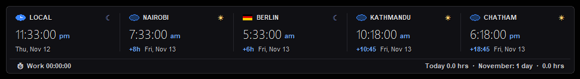

## Features

- **World clocks.** Choose from the IANA time zone database. Each clock shows the local date and how far ahead or behind you it is, down to the minute.
- **Reminders.** Enter a date and time in the zone where an event is scheduled. For a handoff at 09:00 in Nairobi, choose `Africa/Nairobi` and enter `09:00`. Keep the app running to receive the reminder.
- **Work timer.** Pause when you step away and see your hours for the day and month. Sessions are stored in `~/.world_clock_work_tracker.db` on your computer.
- **Overlay controls.** Drag the clock where you want it, switch between horizontal and vertical layouts, and adjust the opacity. On Windows, clicks on the empty background pass through to the window below.

## Screenshots

### Vertical layout

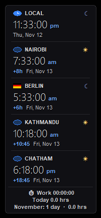

### Themes

| Frosted Light | Cyberpunk Neon | Nordic Frost |
| --- | --- | --- |
| 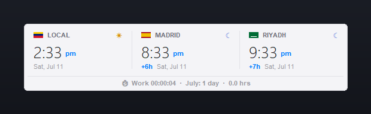 | 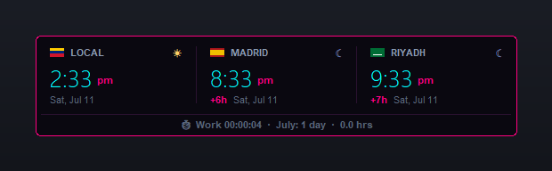 | 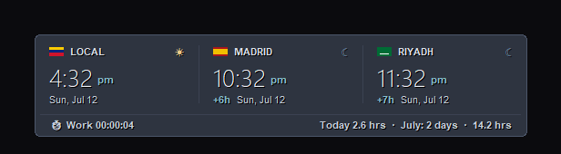 |

| Raycast Dark | Liquid Glass |
| --- | --- |
| 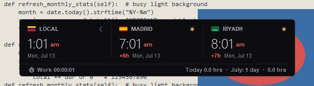 | 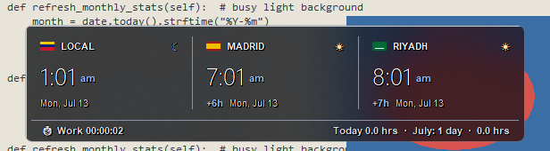 |

### Setup wizard

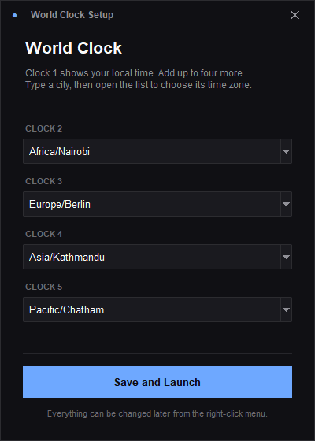

## Demos

### Pause with the space bar

Hover over the overlay and hold Space for half a second. Hold it again to resume.


### Pause with a click

Click the work timer to pause or resume.

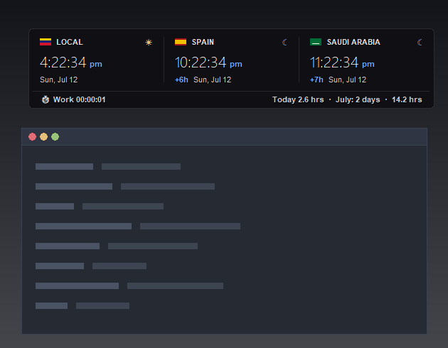

### Scroll-wheel opacity

Scroll over the overlay to adjust its opacity. In Liquid Glass, scrolling changes the tint.

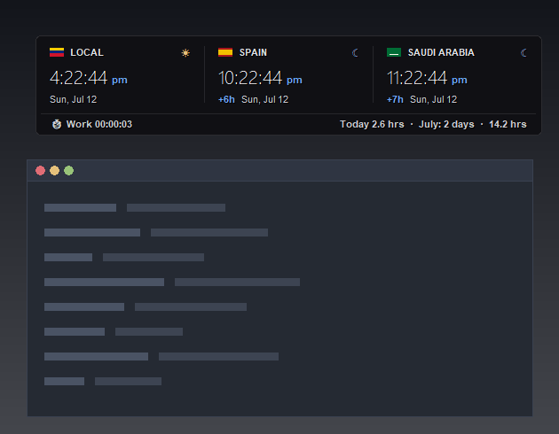

### Theme menu

Right-click the overlay and choose a theme.

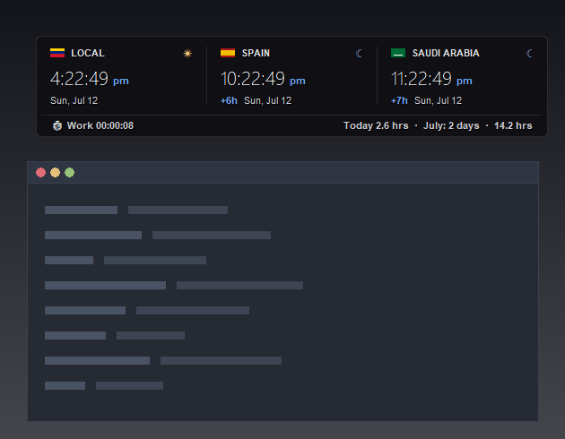

### Layout toggle

Double-click to switch layouts. The overlay stays anchored to the nearest screen corner.

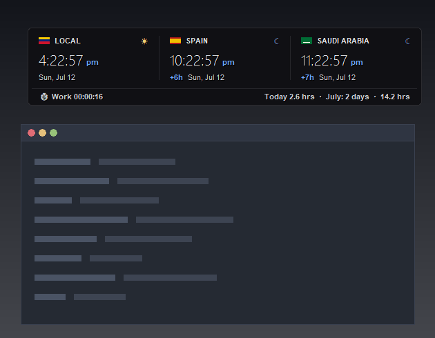

## Running the application

### Windows

You’ll need CPython 3.11–3.15 with Tkinter and [uv](https://docs.astral.sh/uv/getting-started/installation/). In PowerShell, open the project folder and run the following commands.

```powershell
uv venv --no-python-downloads --python 3.12 .venv
uv pip sync --python .venv --require-hashes --only-binary :all: --default-index https://pypi.org/simple requirements-windows.txt
.\.venv\Scripts\python.exe clock.py
```

Use your installed Python version in the first command. The requirements file pins the Windows dependencies and checks their hashes. It includes the time zone data for remote clocks and reminders, plus the packages for the tray icon and Liquid Glass. After setup, double-click `run_clock.bat` to launch the overlay.

### WSL

Use a distribution with Linux GUI support, Python 3.9 or newer, Tkinter, and system time zone data. The package names for Tkinter and time zone data on Debian and Ubuntu are `python3-tk` and `tzdata`.

```bash
python3 clock.py
```

The repository also contains an older Electron prototype. Its Electron 31 runtime is end-of-support. The instructions above run the Python app.

## Controls

- **Change clocks.** In the setup wizard, type a city or region, then open the list to choose a time zone. To reopen the wizard, right-click and choose **Reset Clocks Setup Wizard**.
- **Set a reminder.** Right-click and choose **Add Reminder…**. Select a zone, enter the date and time there, and choose how far ahead you want a warning. On Windows, you can get a tray alert and a beep. When the reminder is due, you can dismiss it or snooze it for five minutes.
- **Hide to tray.** With the tray icon active, hover over the overlay and press H. Single-click the tray icon to take a quick look. Double-click to restore the overlay.
- **Show Liquid Glass in a recording.** On Windows, Liquid Glass hides the overlay and its menus from screen capture. Hover and press Delete to toggle demo mode, which shows the overlay with a frozen backdrop.
- **Change the display.** Right-click for 12- or 24-hour time, seconds, opacity, and themes. The app saves these preferences and its position in `~/.world_clock_overlay.json`.

## Tests

Run the tests in PowerShell after setting up the Windows virtual environment.

```powershell
.\.venv\Scripts\python.exe test_layout.py
.\.venv\Scripts\python.exe test_wheel_stats.py
```

The layout tests check spacing between labels, dates, and icons. The behavior tests open the overlay with a temporary configuration and database.
